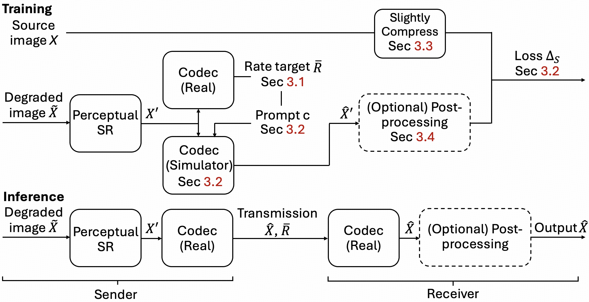
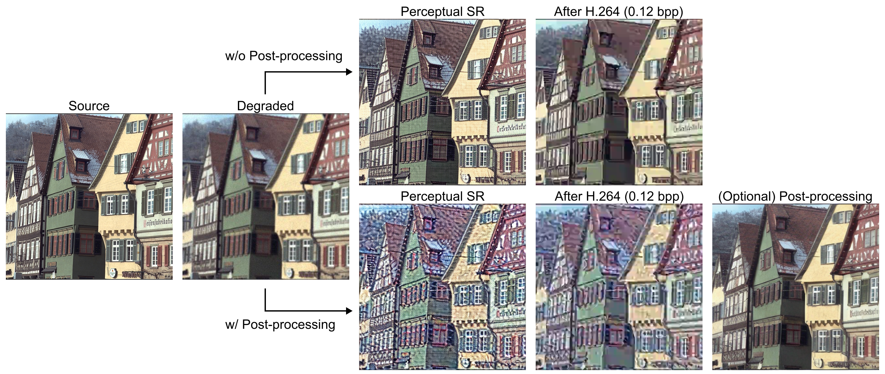
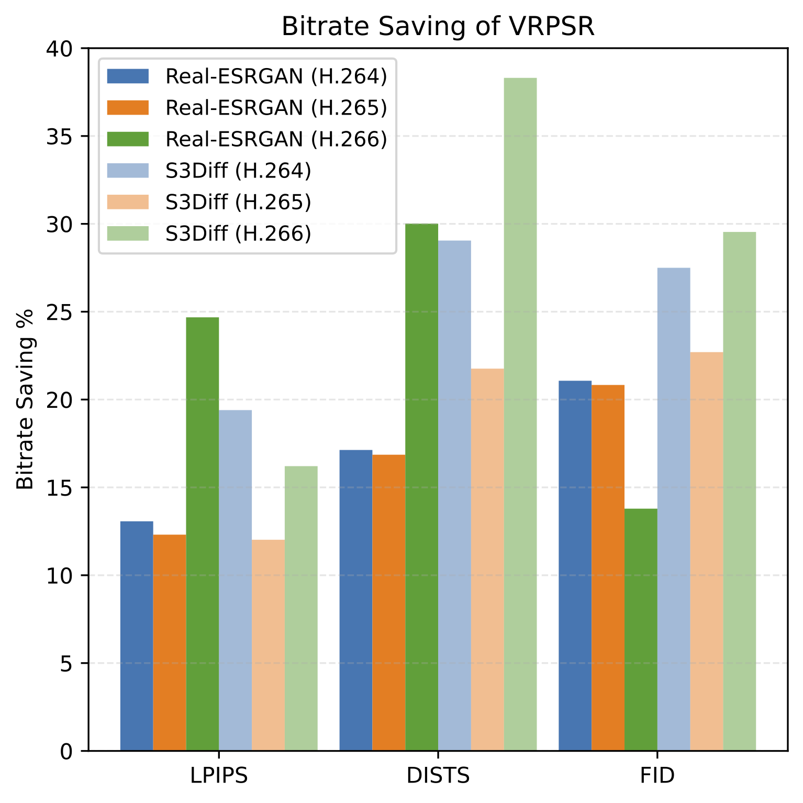

# VRPSR: Super-Resolución Perceptual de Imágenes Versátil y Consciente de la Recompresión

<p align="center">
  <a href="https://arxiv.org/abs/2511.18090">
    
  </a>
  <a href="https://arxiv.org/pdf/2511.18090">
    
  </a>
  <a href="https://huggingface.co/agus-official/vrpsr-checkpoints">
    
  </a>
  
  
  <a href="#-license">
    
  </a>
</p>

<p align="center">
  <b>Haz que tus modelos de SR perceptual sean conscientes del códec que les sigue.</b><br/>
  <sub>Optimizado para la calidad visual posterior al códec bajo H.264 / H.265 / H.266.</sub>
</p>

<p align="center">
  
</p>

<p align="center">
  <em>
    En los sistemas reales, las imágenes se restauran y <strong>luego</strong> se recomprimen.
    VRPSR entrena modelos de SR para lo que el espectador realmente ve: la imagen <strong>recomprimida</strong>.
  </em>
</p>

---

> **Artículo:** https://arxiv.org/abs/2511.18090  
> **PDF:** https://arxiv.org/pdf/2511.18090  
> **Código:** https://github.com/agus-official/VRPSR  
> **Puntos de control:** https://huggingface.co/agus-official/vrpsr-checkpoints  

---

## 🔗 Tabla de Contenidos

- [🚀 Resumen](#-tldr)
- [🧩 ¿Qué es VRPSR?](#-what-is-vrpsr)
- [📦 Estado del Proyecto](#-project-status)
- [🧠 Resumen del Método](#-method-overview)
- [⚙️ Instalación y Configuración](#%EF%B8%8F-installation--setup)
- [💾 Puntos de Control Preentrenados](#-pretrained-checkpoints)
- [🌫 Modelo de Difusión Base (`sd_path`)](#-base-diffusion-model-sd_path)
- [🧱 Envoltorio de Códec en C++](#-c-codec-wrapper)
- [🏁 Inicio Rápido: Scripts de Una Línea](#-quickstart-one-line-scripts)
- [💻 Ejemplos de Uso en CLI](#-cli-usage-examples)
- [📚 Citación](#-citation)
- [📜 Licencia](#-license)
- [🤝 Agradecimientos](#-acknowledgements)

---

## 🚀 Resumen

En muchos flujos de trabajo reales, las imágenes pasan por:

> **Entrada LR → SR Perceptual → Compresión H.264/H.265/H.266 → Espectador**

La mayoría de los modelos de SR optimizan solo la salida **previa a la compresión**, ignorando el códec que les sigue.

**VRPSR** hace que los modelos existentes de SR perceptual sean **conscientes de la recompresión** y **conscientes del códec** mediante:

- Aprender un **simulador de códec diferenciable** construido sobre un potente modelo de difusión,
- Condicionar el SR al **tipo de códec** y al **bitrate objetivo / QP**,  
- Entrenar el SR para optimizar directamente la calidad perceptual **posterior al códec**.

Este repositorio proporciona **código de inferencia + modelos preentrenados** para VRPSR, listos para integrarse en tu flujo de trabajo.

---

## 🧩 ¿Qué es VRPSR?

La super-resolución perceptual de imágenes (p. ej., Real-ESRGAN, S3Diff) produce imágenes nítidas a partir de entradas degradadas, pero en la práctica estas imágenes se **recomprimen** para su almacenamiento o distribución. Sin conciencia de la recompresión:

- Los detalles finos del SR pueden convertirse en artefactos del códec,
- Se desperdicia bitrate en detalles que el códec destruirá de todos modos,
- Los diferentes códecs / configuraciones (H.264/H.265/H.266, varios QP/bpp) se comportan de manera muy diferente.

**VRPSR (Versatile Recompression-Aware Perceptual SR)** es un marco de trabajo que:

- Trata la **compresión como una tarea condicional de texto a imagen**,  
- Utiliza un **modelo de difusión preentrenado** para construir un **simulador de códec** condicionado al tipo de códec + bitrate objetivo,  
- Entrena modelos de SR **a través** de este simulador para optimizar la calidad posterior al códec.

Las ideas clave y trucos de entrenamiento incluyen:

- **Simulador orientado a tasa**: predice directamente la imagen posterior al códec en un bitrate deseado (bpp), en lugar de aproximar parámetros internos del códec,
- **Objetivo de entrenamiento perceptual** para el simulador (orientado a LPIPS/DISTS/FID), no solo MSE,
- **Supervisión ligeramente comprimida** para el SR (objetivos limpios pero realistas),
- **Optimización en dos etapas** (primero el simulador, luego el SR a través de un simulador congelado),
- **Sin STE** (Straight-Through Estimator) — descubrimos que usar la salida del simulador directamente funciona mejor.

Empíricamente, VRPSR:

- Ahorra **10–40 % del bitrate** a una calidad perceptual equivalente (LPIPS/DISTS/FID),
- Funciona con **Real-ESRGAN** (basado en GAN) y **S3Diff** (basado en difusión),
- Maneja **H.264 / H.265 / H.266** en un amplio rango de bitrates.

---

## 📦 Estado del Proyecto

> ✅ Disponible en este repositorio · ⏳ Planeado / En desarrollo

- ✅ **Código de inferencia** para:
  - Simulador de códec **VRPSR**
  - Backbones de SR mejorados con VRPSR:
    - 🌀 **SR basado en difusión** (estilo S3Diff)
    - 🐼 **SR basado en GAN** (estilo Real-ESRGAN)
  - Variante opcional de **postprocesado / “sándwich”**:
    > Pre-SR → Códec → Post-SR
- ✅ **Puntos de control preentrenados**  
  → Alojados en Hugging Face:  
  https://huggingface.co/agus-official/vrpsr-checkpoints
- ⏳ **Código de entrenamiento**  
  Planeado para su lanzamiento público en una futura actualización.

---

## 🧠 Resumen del Método

<p align="center">
  
</p>

En términos generales, VRPSR consta de tres partes:

### 1️⃣ Simulador de Códec Basado en Difusión

- Entrenado para imitar códecs reales (**H.264 / H.265 / H.266**) a diferentes bitrates,
- Formulado como **generación condicional de texto a imagen**:
  - Entrada: imagen de salida del SR + “indicación del códec” (tipo de códec, bpp),
  - Salida: reconstrucción posterior al códec,
- Construido sobre un backbone **distilado de Stable Diffusion / estilo S3Diff**,
- Totalmente **diferenciable**, por lo que los gradientes fluyen a través de la etapa del códec durante el entrenamiento.

### 2️⃣ Backbones de SR Conscientes del Códec

Dotamos a los modelos de SR existentes de conciencia del códec:

- 🌀 **SR por difusión estilo S3Diff**  
- 🐼 **SR por GAN estilo Real-ESRGAN**

Ambos están condicionados por:

- Tipo de códec (p. ej. `libx264`, `libx265`, `vvenc`),
- Bitrate objetivo o QP.

La condicional se inyecta mediante **incrustaciones de códec** (similares a incrustaciones de tiempo / AdaIN).

### 3️⃣ Variante “Sándwich” Opcional (Pre-SR → Códec → Post-SR)

Para mejorar aún más la robustez a bajo bitrate, VRPSR también admite:

> **Pre-SR → Códec (real o simulado) → Post-SR**

- El **Pre-SR** prepara la imagen para la compresión,
- El **Post-SR** elimina los artefactos residuales del códec,
- Ambos pueden **optimizarse conjuntamente** a través del simulador diferenciable.

<p align="center">
  
</p>

---

## 📈 Destacados de Rendimiento
<p align="center">
  
</p>
<p align="center"><em>VRPSR ahorra consistentemente más del 10 % del bitrate en todos los códecs (H.264/H.265/H.266) y backbones de SR.</em></p>

## ⚙️ Instalación y Configuración

### 1. Clona el repositorio e inicializa los submódulos

```bash
git clone https://github.com/agus-official/VRPSR.git
cd VRPSR
git submodule update --init --recursive
```

### 2. Entorno de Python y PyTorch

Recomendamos:

- **Python** ≥ 3.8 (los experimentos usaron 3.8.10),
- Una **GPU con CUDA** con ≥ 12 GB de VRAM.

Ejemplo con `conda`:

```bash
conda create -n vrpsr python=3.8 -y
conda activate vrpsr
```

Instala **PyTorch** para tu sistema (consulta las instrucciones oficiales de PyTorch), luego:

```bash
pip install -r requirements.txt
```

------

## 💾 Puntos de Control Preentrenados

Todos los puntos de control de VRPSR están alojados en **Hugging Face**:

> https://huggingface.co/agus-official/vrpsr-checkpoints

Justo después de clonar el repositorio, deberías:

### Opción A: Descarga manual

Descarga los archivos en `VRPSR/checkpoints/`:

```text
VRPSR/checkpoints/
  de_net.pth
  simulator.pkl
  vrpsr_s3diff.pkl
  vrpsr_realesrgan.pkl
  pre_sr.pkl
  post_sr.pkl
```

### Opción B: Con `git lfs`

```bash
cd VRPSR
git lfs install

git clone https://huggingface.co/agus-official/vrpsr-checkpoints hf_ckpts
cp hf_ckpts/checkpoints/* checkpoints/
```

> Si utilizas una estructura de carpetas diferente, simplemente apunta las banderas de CLI
>  (`--de_net_path`, `--pretrained_*_path`) a tus rutas personalizadas.

------

## 🌫 Modelo de Difusión Base (`sd_path`)

El simulador y los modelos de SR de VRPSR se basan en un **modelo de difusión base** (p. ej., S3Diff / Stable Diffusion distilado).

Todos los scripts de inferencia aceptan:

```bash
--sd_path /path/to/your/base_diffusion_model
```

Puedes:

1. **Preparar `sd_path` tú mismo**
   - Descarga un punto de control de modelo base compatible,
   - Reutilízalo en múltiples ejecuciones para un inicio más rápido y uso sin conexión.
2. **Dejar que el script descargue automáticamente**
   - Si se omite `--sd_path`, los scripts intentan **descargar automáticamente** el modelo base por defecto,
   - Requiere acceso a la red y más tiempo en la primera ejecución.

Si no estás seguro, comienza con la descarga automática una vez y luego almacénalo en caché mediante `--sd_path`.

------

## 🧱 Envoltorio de Códec en C++

Los scripts de Python llaman a una biblioteca compartida de C++ para operaciones de códec eficientes.

### 1. Compila la biblioteca compartida

Desde la raíz del repositorio:

```bash
cd VRPSR
cd cpp
mkdir build && cd build
cmake ../
make -j
```

Después de compilar, deberías ver algo como:

```text
VRPSR/cpp/build/codecsimulator.cpython-38-x86_64-linux-gnu.so
```

> El prefijo `codecsimulator` y el sufijo `.so` son fijos;
>  la parte central depende de la versión de Python y la plataforma.

### 2. Hazlo visible para Python

Copia el `.so` generado en `src/`:

```bash
cd VRPSR  # raíz del repositorio

cp cpp/build/codecsimulator*.so src/
```

Ahora Python puede importar el envoltorio del códec.

------

## 🏁 Inicio Rápido: Scripts de Una Línea

Proporcionamos scripts de conveniencia en `scripts/`. Ejecútalos desde `VRPSR/`:

```bash
# Simulador de códec vs códec real
bash scripts/inference_sim.sh

# VRPSR con SR basado en difusión (estilo S3Diff)
bash scripts/inference_sr_s3diff.sh

# VRPSR con SR basado en GAN (estilo Real-ESRGAN)
bash scripts/inference_sr_realesrgan.sh

# Pipeline completo de sándwich: Pre-SR → Códec → Post-SR
bash scripts/inference_post.sh
```

Estos scripts asumen:

- Puntos de control en `checkpoints/`,
- Imágenes de prueba en `datasets/kodak/` (PNG/JPEG),
- `codecsimulator*.so` copiado en `src/`,
- `--sd_path` opcional configurado dentro de los scripts (u omitido para descarga automática).

Siéntete libre de copiarlos y modificarlos para tus propios conjuntos de datos/códecs/QP.

------

## 💻 Ejemplos de Uso en CLI

Todos los ejemplos a continuación utilizan **una GPU** mediante `accelerate`:

> Puede ser necesario ejecutar `accelerate config` una vez para crear una configuración predeterminada.

> Nota: todos los comandos aceptan `--sd_path /path/to/base_diffusion_model`.
>  Si se omite, el script descarga automáticamente el modelo base predeterminado.

------

### 1️⃣ Inferencia del Simulador de Códec

Aproxima el efecto de un códec real:

```bash
cd VRPSR

accelerate launch \
  --num_processes=1 \
  --gpu_ids "0" \
  --main_process_port 29300 \
  src/inference_sim.py \
  --de_net_path checkpoints/de_net.pth \
  --pretrained_path checkpoints/simulator.pkl \
  --ref_path datasets/kodak \
  --output_dir result_sim/sim \
  --rec_save_dir result_sim/real \
  --fixed_codec_type libx264 \
  --fixed_qp 33
  # Opcional:
  # --sd_path /path/to/sd-base
```

Banderas clave:

- `--ref_path` : imágenes de entrada (PNG/JPEG),
- `--fixed_codec_type` : códec objetivo (`libx264`, `libx265`, `vvenc`, …),
- `--fixed_qp` : QP (p. ej., 22/27/32/37),
- `--output_dir` : salidas del **simulador**,
- `--rec_save_dir` : salidas del **códec real** para comparación.

Úsalo para estudiar la **fidelidad del simulador** y realizar experimentos “hipotéticos”.

------

### 2️⃣ VRPSR + SR Basado en Difusión (estilo S3Diff)

Ejecuta SR mejorado con VRPSR con un backbone de difusión:

```bash
accelerate launch \
  --num_processes=1 \
  --gpu_ids "0" \
  --main_process_port 29300 \
  src/inference_sr.py \
  --de_net_path checkpoints/de_net.pth \
  --pretrained_sr_path checkpoints/vrpsr_s3diff.pkl \
  --model s3diff \
  --ref_path datasets/kodak \
  --fixed_codec_type libx264 \
  --fixed_qp 32 \
  --output_dir result_sr_s3diff \
  --output_combined_dir result_sr_s3diff_collage
  # Opcional:
  # --sd_path /path/to/sd-base
```

Notas:

- `--model s3diff` selecciona el backbone de SR por difusión,
- `--output_combined_dir` guarda collages para una inspección cualitativa rápida.

Esto corresponde a **“VRPSR (S3Diff)”** en el artículo.

------

### 3️⃣ VRPSR + SR Basado en GAN (estilo Real-ESRGAN)

Ejecuta VRPSR con un backbone de GAN:

```bash
accelerate launch \
  --num_processes=1 \
  --gpu_ids "0" \
  --main_process_port 29300 \
  src/inference_sr.py \
  --de_net_path checkpoints/de_net.pth \
  --pretrained_sr_path checkpoints/vrpsr_realesrgan.pkl \
  --model realesrgan \
  --ref_path datasets/kodak \
  --fixed_codec_type libx264 \
  --fixed_qp 32 \
  --output_dir result_sr_realesrgan \
  --output_combined_dir result_sr_realesrgan_collage
  # Opcional:
  # --sd_path /path/to/sd-base
```

La interfaz es idéntica al caso de difusión; solo difieren el backbone y el punto de control.

------

### 4️⃣ Variante “Sándwich”: Pre-SR → Códec → Post-SR

Usa tanto los modelos de pre-SR como de post-SR:

```bash
accelerate launch \
  --num_processes=1 \
  --gpu_ids "0" \
  --main_process_port 29300 \
  src/inference_post.py \
  --de_net_path checkpoints/de_net.pth \
  --pretrained_sr_path checkpoints/pre_sr.pkl \
  --pretrained_post_path checkpoints/post_sr.pkl \
  --ref_path datasets/kodak \
  --fixed_codec_type libx264 \
  --fixed_qp 33 \
  --output_dir result_post \
  --output_combined_dir result_post_collage
  # Opcional:
  # --sd_path /path/to/sd-base
```

Uso previsto:

- **Pre-SR**: moldea la imagen antes de la compresión,
- **Post-SR**: refina y desensuida la imagen comprimida.

------

## 📚 Citación

Si encuentras útil VRPSR en tu investigación, considera citarlo:

```bibtex
@misc{he2025versatilerecompressionawareperceptualimage,
      title={Versatile Recompression-Aware Perceptual Image Super-Resolution}, 
      author={Mingwei He and Tongda Xu and Xingtong Ge and Ming Sun and Chao Zhou and Yan Wang},
      year={2025},
      eprint={2511.18090},
      archivePrefix={arXiv},
      primaryClass={cs.CV},
      url={https://arxiv.org/abs/2511.18090}, 
}
```

------

## 📜 Licencia

El código y los modelos preentrenados se publican bajo:

> **Creative Commons Attribution-NonCommercial 4.0 International (CC BY-NC 4.0)**

Puedes:

* Compartir y adaptar el material con fines **no comerciales**,
* Siempre que proporciones la atribución adecuada e indiques si se realizaron cambios.

Para **uso comercial**, por favor contacta a los autores.

Más detalles: [https://creativecommons.org/licenses/by-nc/4.0/](https://creativecommons.org/licenses/by-nc/4.0/)

---

## 🤝 Agradecimientos

VRPSR se construye sobre y se beneficia de varios proyectos de código abierto, entre ellos:

* **Real-ESRGAN**
* **S3Diff / Stable Diffusion**
* **Diffusers**, **Accelerate** y bibliotecas relacionadas
* Códecs tradicionales: **x264**, **x265**, **vvenc**

Un enorme agradecimiento a la comunidad de código abierto por hacer posible este trabajo. 💙

Si te gusta este proyecto, considera ★ marcar el repositorio con una estrella para apoyar futuros lanzamientos.
